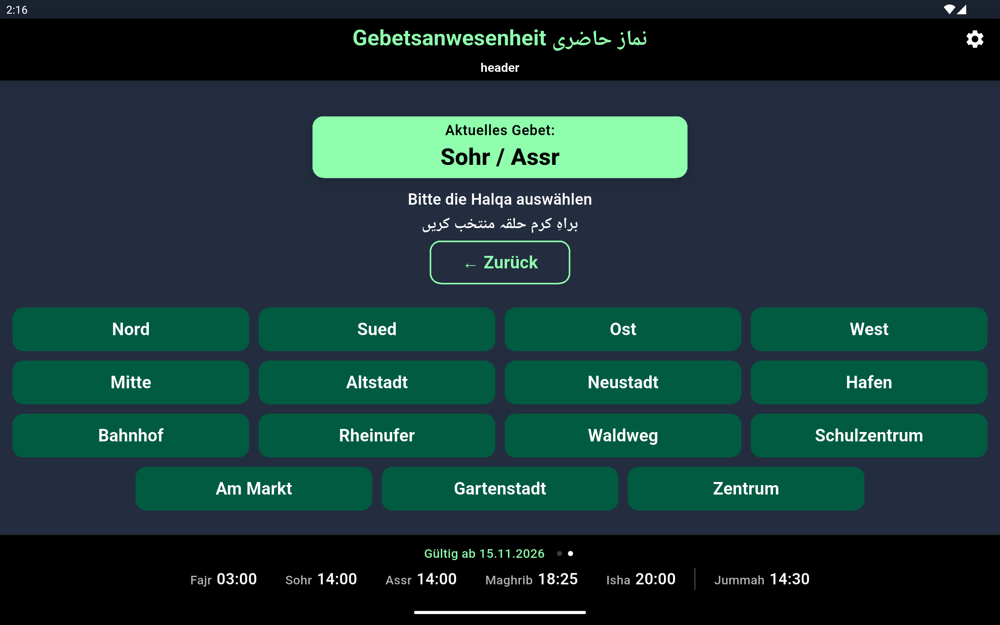
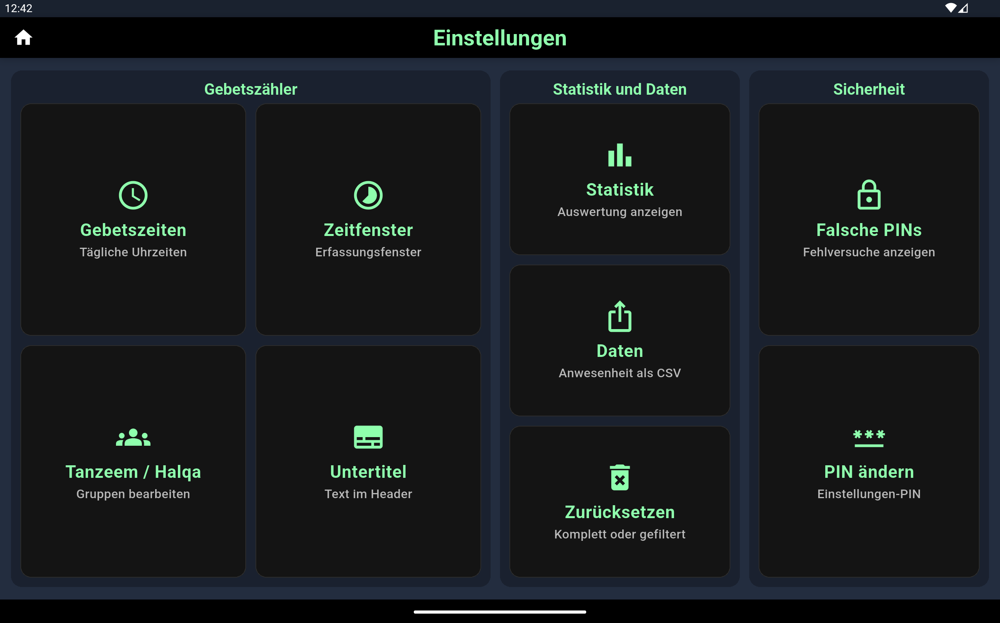
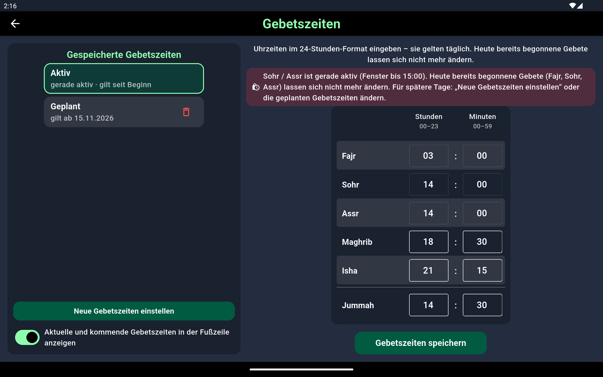
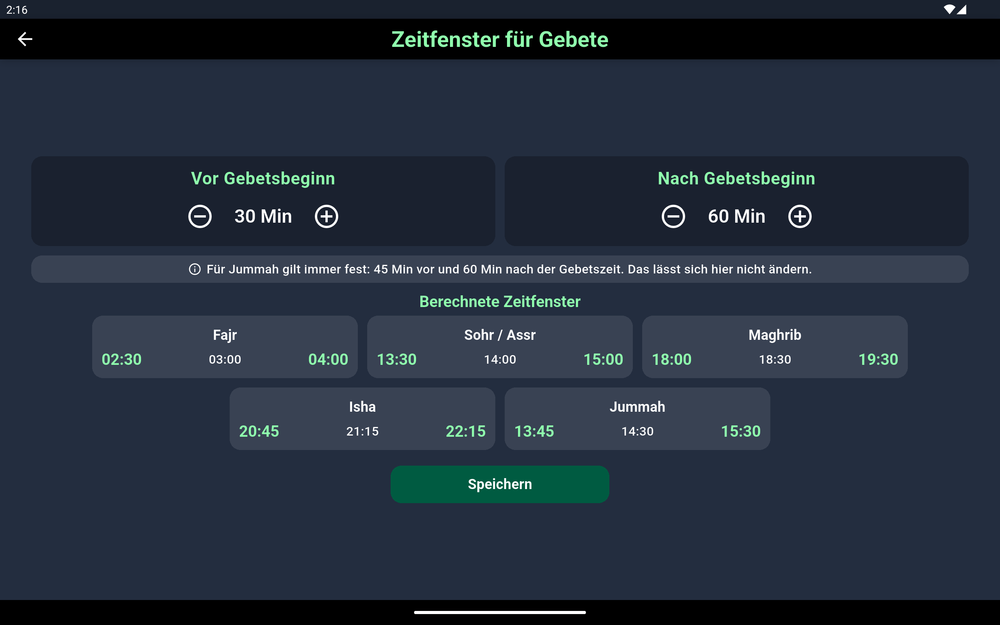
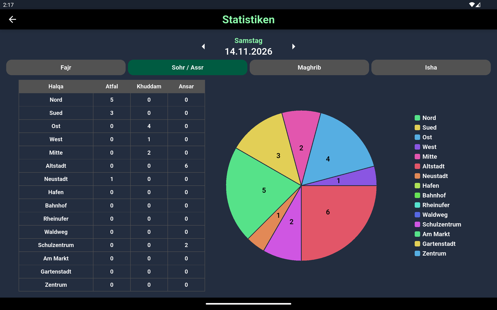
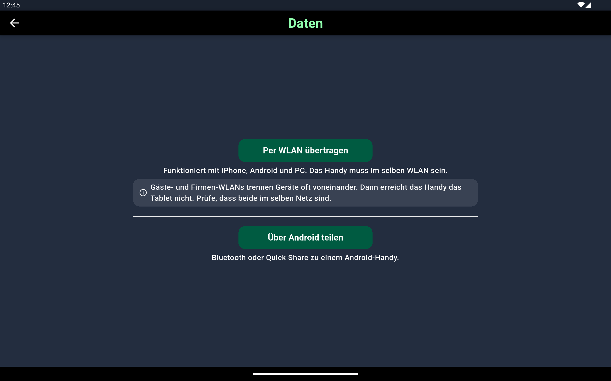
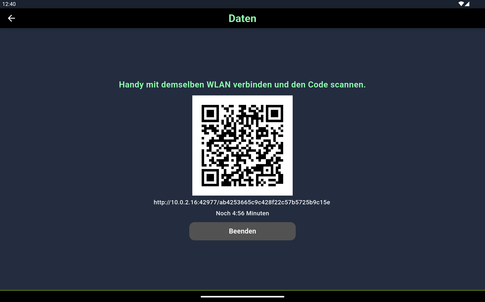

# SalatAttendance Community

Offline-App für Android-Tablets zur Erfassung der Gebetsanwesenheit. Besucher tippen Tanzeem und Halqa an, die App zählt für das aktuelle Gebet. Ohne Konto und ohne Cloud, alle Daten bleiben auf dem Gerät. Nur auf Wunsch lässt sich die Anwesenheit als CSV übertragen.


## Funktionen

- **Erfassung in zwei Taps:** aktuelles Gebet oben, dann Tanzeem und Halqa wählen. Das Gebet ergibt sich aus der Uhrzeit.
- **Gebetszeiten mit Startdatum:** mehrere Sätze, jeweils „gültig ab“ einem Datum (aktiv, geplant, beendet). Heute bereits begonnene Gebete lassen sich nicht mehr ändern.
- **Jummah:** freitags ersetzt Jummah das Sohr-Gebet, das Fenster ist fest 45 Min davor und 60 Min danach.
- **Zeitfenster:** global einstellbar (Minuten vor/nach Gebetsbeginn), die berechneten Fenster werden angezeigt.
- **Prüfungen:** Reihenfolge der Gebete, überlappende Fenster, doppelte Gruppennamen.
- **Tanzeem/Halqa:** 2 bis 16 Einträge, ab 9 in zwei Spalten.
- **Statistik:** je Tag und Gebet als Tabelle und Kreisdiagramm, Zurücksetzen komplett oder gefiltert.
- **Sicherheit:** Einstellungen nur mit sechsstelliger PIN, Fehlversuche werden protokolliert, nach 10 Fehlversuchen kurze Sperre.
- **Fußzeile:** aktuelle und kommende Gebetszeiten mit „Gültig bis/ab“, abschaltbar.
- **Daten übertragen:** die Anwesenheit als CSV (für Excel oder Numbers), auf zwei Wegen (siehe [Daten übertragen](#daten-übertragen)).

## Bilder

| | |
|---|---|
|  |  |
|  |  |
|  |  |
|  | |

## Installation

1. APK von der [Release-Seite](../../releases/latest) herunterladen und auf dem Tablet installieren (Android 7.0 oder neuer, „Unbekannte Quellen“ erlauben).
2. Ersteinrichtung: Gebetszeiten, Zeitfenster, Tanzeem/Halqa und eine eigene sechsstellige Einstellungen-PIN festlegen. Verwende für diese App eine eigene PIN.
3. Später lässt sich alles unter **Einstellungen** ändern.

## Daten übertragen

Unter **Einstellungen → Statistik und Daten → Daten** lässt sich die gesamte Anwesenheit als CSV-Datei (`anwesenheit-JJJJ-MM-TT.csv`, Semikolon, UTF-8) übertragen. Die Spalten sind Datum, Gebet, Tanzeem, Halqa und Anzahl.

**Per WLAN übertragen** (iPhone, Android und PC)
1. Das Tablet muss mit einem WLAN verbunden sein. Sonst bleibt der Knopf gesperrt.
2. Auf „Per WLAN übertragen“ tippen. Das Tablet zeigt einen QR-Code und die Adresse.
3. Das Handy mit demselben WLAN verbinden, den Code mit der Kamera scannen und im Browser „Herunterladen“ wählen.

Die App bietet die Datei dabei nur kurz im lokalen Netz an, nicht im Internet. Der Link enthält einen zufälligen Code. Die Übertragung endet nach dem Download, nach 5 Minuten, über „Beenden“ oder wenn das WLAN wegfällt. Gäste- und Firmen-WLANs trennen Geräte oft voneinander. Dann erreicht das Handy das Tablet nicht, beide müssen im selben Netz sein.

**Über Android teilen**
Öffnet das Teilen-Menü von Android, zum Beispiel für Bluetooth oder Quick Share zu einem Android-Handy. Zum iPhone funktioniert dieser Weg nicht, dafür gibt es die WLAN-Übertragung.

## Selbst bauen

Voraussetzungen: Flutter mit Dart ab 3.10.1, JDK 17 oder 21, Android SDK mit API 36.

```sh
flutter pub get
flutter test
flutter run
```

`flutter build apk --debug` erstellt eine lokal installierbare Test-APK. Für ein signiertes Release eine eigene Signatur und die lokale `android/key.properties` mit `storeFile`, `storePassword`, `keyAlias` und `keyPassword` einrichten, dann `flutter build apk --release`. Keystore und `key.properties` gehören nicht ins Repository.

## Datenschutz

Die App arbeitet offline und sendet keine Daten ins Internet. Die Internetberechtigung wird nur für die WLAN-Übertragung im lokalen Netz gebraucht und nur auf Knopfdruck genutzt. Siehe [PRIVACY.md](PRIVACY.md).

## Lizenz

[MIT](LICENSE)

## Webseite

Die Projektseite liegt in [`site/`](site/) und wird per GitHub Pages veröffentlicht (Workflow `.github/workflows/pages.yml`). Einmalig im Repository unter Settings → Pages die Quelle „GitHub Actions“ wählen.
